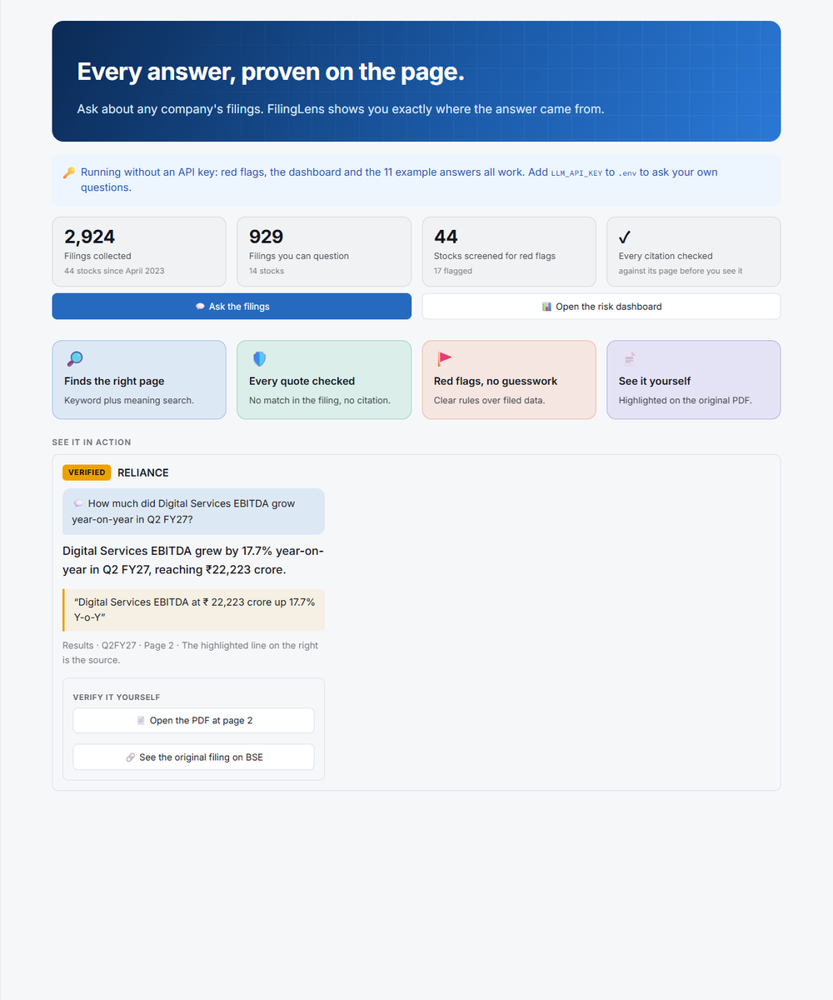
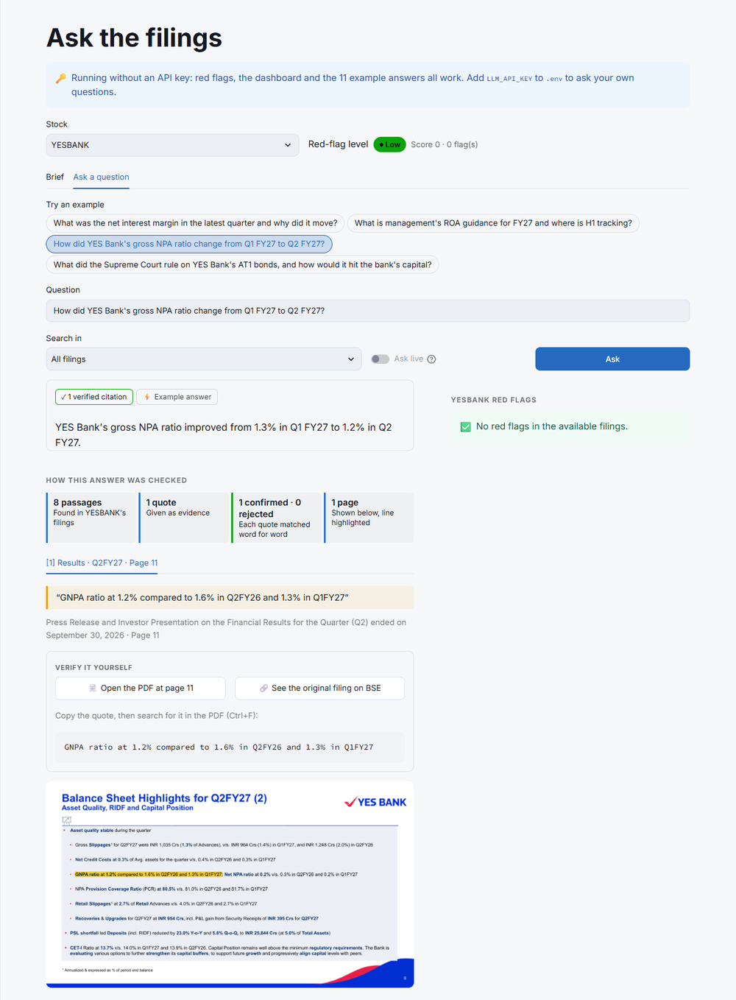
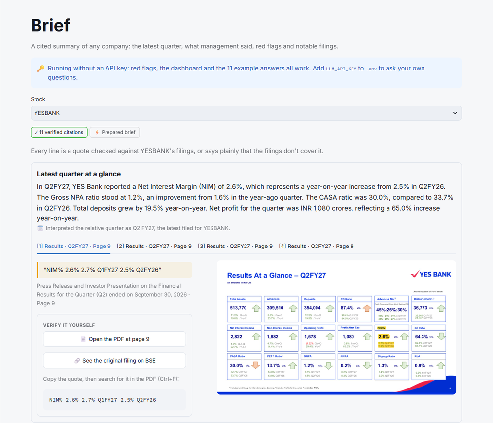
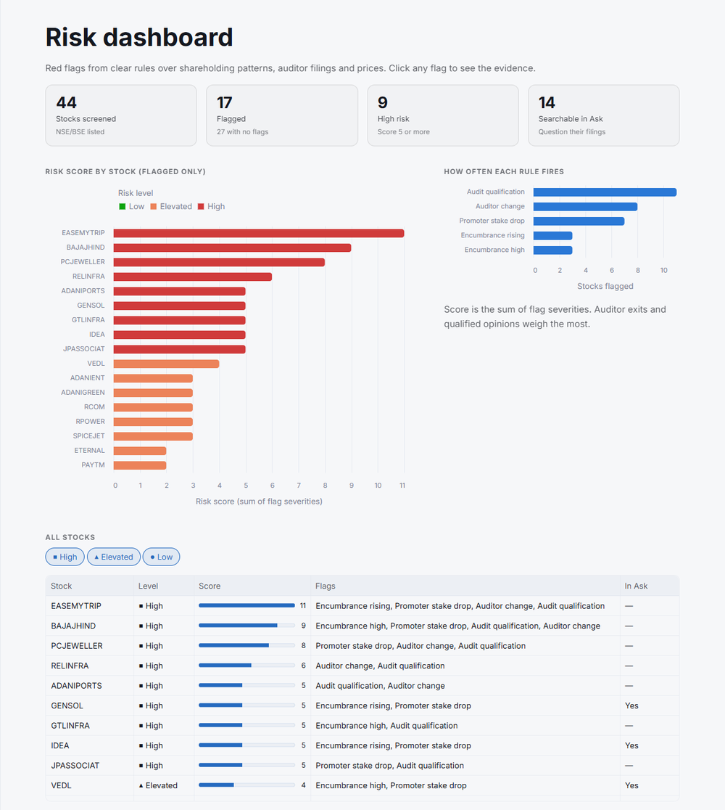
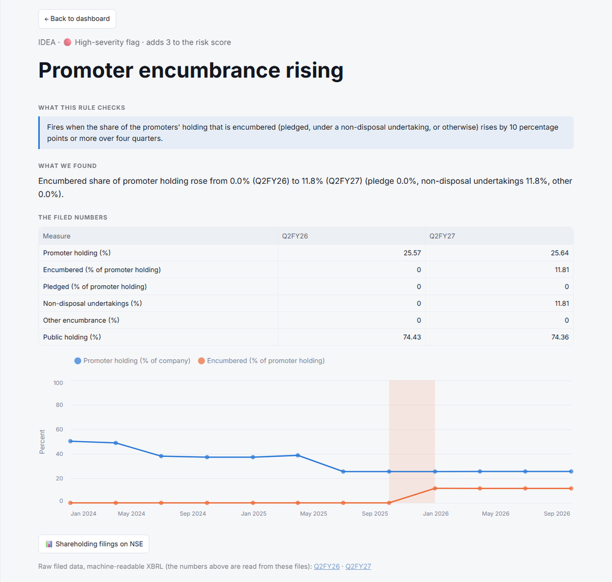
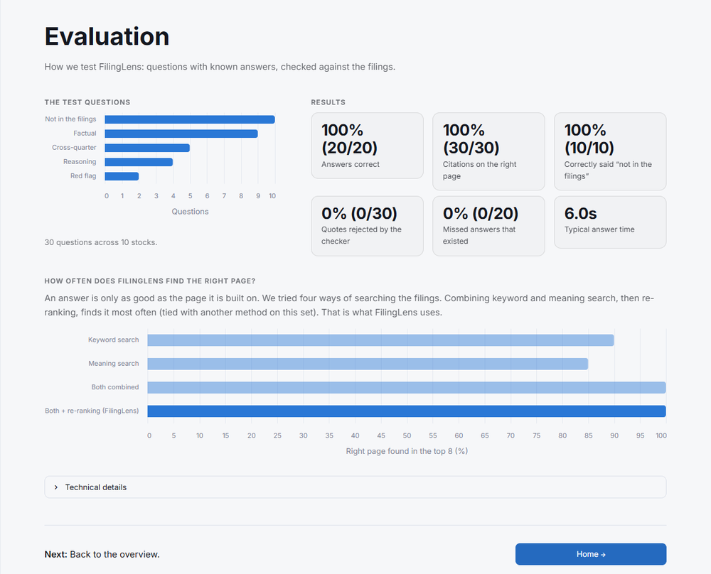
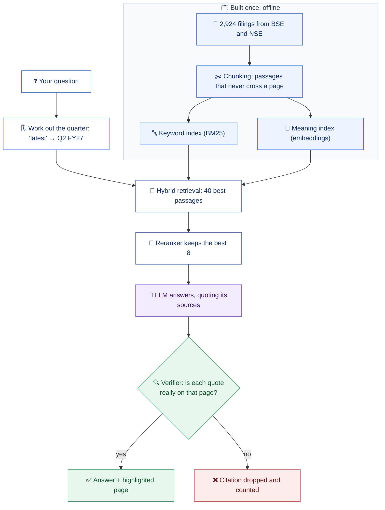

# FilingLens

### Answers from Indian company filings, proven on the page

**Ask a question about a listed company. Get a plain answer, plus the exact page of the company's own filing it came from, with the sentence highlighted.**

Built solo for **Arthaton 2026** (AI for personal and business finance).
🎬 **Demo video:** _<YouTube link>_ · 📦 **Data download:** [v1.0-data release](https://github.com/Palak8825/Filinglens/releases/tag/v1.0-data)



**Contents:** [Why FilingLens?](#why-filinglens) · [See it in action](#see-it-in-action) · [How it works](#how-it-works) · [Quick start](#quick-start) · [Does it work? (Evaluation)](#does-it-work-evaluation) · [Red flags](#red-flags) · [Limitations](#limitations) · [Under the hood](#under-the-hood) (models, API, **project structure**, engineering notes)

---

## Why FilingLens?

Every listed company in India files its quarterly results, earnings-call transcripts and shareholding details with the stock exchanges. It's all public, and it's the most reliable information there is. But it runs to **hundreds of pages per company per quarter**, mostly dense PDFs and tables.

You could paste a filing into a chatbot, but chatbots sometimes **make things up**: a confident number, a quote nobody ever said. With money involved, "probably right" isn't good enough.

FilingLens is built around one rule: **if it can't show you the page, it doesn't say it.**

- 📄 **Every claim comes with its source page**, with the exact sentence highlighted, and a button to open the original PDF.
- ✅ **Every quote is checked by code before you see it.** If the AI cites something that isn't on that page, the citation is thrown out.
- 🚩 **Warning signs from simple, visible rules**, not AI guesswork. For example, "promoters pledged more of their shares" or "the auditor resigned", each with the filing that proves it.
- 📊 **It's measured.** 30 hand-checked test questions, published results, including where it fails.

> **Who it's for:** a retail investor doing homework before buying a stock, a student learning to read company results, or anyone who wants to check what a company *actually* said. It's a research tool: no trading, no tips, no money involved.

---

## See it in action

**Example:** *"How did YES Bank's gross NPA ratio change from Q1 FY27 to Q2 FY27?"*

> **Answer:** YES Bank's gross NPA ratio improved from 1.3% in Q1 FY27 to 1.2% in Q2 FY27.
> **Source:** Results · Q2 FY27 · Page 11, *"GNPA ratio at 1.2% compared to 1.6% in Q2FY26 and 1.3% in Q1FY27"* ✅ verified

The answer shows how it was checked (8 passages read, 1 quote given, 1 confirmed, 0 rejected), and the page itself, with the line highlighted:



### What you can do

| | |
|---|---|
| **📋 Brief:** a one-page summary of any company: the latest quarter's numbers, what management said, red flags and notable filings. Every line is a checked quote; if the filings don't cover something, it says so instead of guessing. |  |
| **🚩 Risk dashboard:** all 44 companies screened for warning signs, with a score, the rules that fired, and promoter holding over time. |  |
| **🔍 Flag details:** click any flag to see the rule, its threshold, the filed numbers and a link to the original filing on NSE. |  |
| **📈 Evaluation:** the test results in plain language, with the technical tables one click away. |  |

---

## How it works

The whole idea fits in one picture: **find the right pages → let the AI answer only from them → check every quote in code.**



Here's what each step does, using the YES Bank question above:

1. **Chunking.** Each filing is cut into passages of about 450 tokens (a few paragraphs) that **never cross a page break**, so every passage knows its exact page number. That's what makes "page 11" possible. Earnings calls are split by speaker, so an analyst's question stays with management's answer.
2. **Understanding the quarter.** "Latest quarter", "Q2 FY27" or "as of 30 September 2026" all become *Q2 FY27*, and the search only looks at that quarter's filings. No AI is needed for this step; it's plain rules.
3. **Retrieval: finding the right pages.** This is **hybrid RAG** (retrieval-augmented generation: the AI answers only from passages that were retrieved for it). Two searches run side by side:
   - **keyword search** (BM25) catches exact terms like "GNPA" or "CASA";
   - **meaning search** (embeddings) catches paraphrases, like "bad loans" for "NPA".

   Their results are merged (Reciprocal Rank Fusion), giving the 40 most promising passages.
4. **Reranking.** A second, sharper model (a cross-encoder) reads each of the 40 passages next to the question and keeps the **best 8**. Only those 8 go to the AI.
5. **Answering.** The LLM (Google Gemini) must answer from those 8 passages only, and back every claim with a **word-for-word quote** and the passage it came from.
6. **Verifying.** Code, not the AI, checks that every quote really appears in the passage it points to. Quotes that don't match are dropped and counted. An answer left with no verified quote is marked "Unverified".
7. **Showing the proof.** Each verified quote is highlighted on a picture of the actual PDF page, with buttons to open the PDF and the original filing on the BSE website.

The **Brief** reuses the same pipeline: it asks a fixed set of questions about each company (latest results, management commentary), then adds the red flags and the **notable filings**. Those are ranked by how rare each type of announcement is across all 44 companies. Indian law (SEBI's Regulation 30) already requires companies to report material events, so FilingLens ranks that legal feed instead of asking an AI what seems important.

There's no vector database and no LangChain: just SQLite, a numpy file and a few hundred lines of retrieval code you can read end to end.

---

## Quick start

You'll need **Python 3.12** (3.10+ should work), Git, and **about 5 GB of free disk space**: ~1 GB for the demo data and the rest for Python packages (PyTorch is the big one). **No API key is needed** to try it.

**1. Get the code**

```bash
git clone https://github.com/Palak8825/Filinglens.git
cd Filinglens
python -m venv .venv
source .venv/bin/activate        # Windows: .venv\Scripts\activate
pip install -r requirements.txt
```

**2. Download the data** from the [v1.0-data release](https://github.com/Palak8825/Filinglens/releases/tag/v1.0-data) into any folder, then unpack it. The script checks every file's checksum first.

| Option | Download | What you get | Command |
|---|---|---|---|
| **Demo** (~500 MB, recommended) | `filinglens-demo.zip` + `SHA256SUMS-demo.txt` | 5 companies (IDEA, PAYTM, RELIANCE, VEDL, YESBANK) you can question, every page the examples cite, red flags for all 44 | `python -m scripts.setup_release <folder> --demo` |
| **Full** (~3.5 GB) | `filinglens-index.zip`, `filinglens-pdfs-part1.zip`, `filinglens-pdfs-part2.zip` + `SHA256SUMS.txt` | 14 companies, 929 filings, 41,219 passages | `python -m scripts.setup_release <folder>` |

If a download stops part-way (on Windows, `curl` sometimes fails with an SSL error), use your browser, or resume with `curl -L --ssl-no-revoke -C - -O <file URL>`.

**3. Run it** (two terminals)

```bash
uvicorn api.main:app             # the engine, on http://localhost:8000
streamlit run web/app.py         # the app, on http://localhost:8501
```

If the engine runs on another port, set `FILINGLENS_API=http://localhost:<port>` before starting the app.

- **Without a key:** the Briefs for the demo companies, the example answers, the dashboard, the red flags and every cited page all work.
- **With a key** (copy `.env.example` to `.env` and set `LLM_API_KEY`; the free [Google AI Studio](https://aistudio.google.com) tier works), you can ask anything about the indexed companies.

**4. Check everything works** (optional): `python -m scripts.selftest` runs offline in under a minute, with no key and no internet, and tests chunking, retrieval, the verifier and the red flags.

<details>
<summary><b>⚡ Why some answers are marked "Example answer"</b></summary>

So that anyone can try FilingLens without an API key, the 11 example questions and the Briefs for the 5 demo companies were generated in advance (`scripts/warm_cache.py`, `scripts/warm_brief.py`) using **exactly the same pipeline the app runs live**. Each one is stored complete, with its verified citations, the model that answered and the date, and carries an **⚡ Example answer** / **⚡ Prepared brief** label. Any question that isn't one of these is always answered live, and live answers are never saved into the examples. This also keeps the demo working if the free AI tier is having a bad day.
</details>

---

## Does it work? (Evaluation)

I wrote **30 test questions** about 10 companies and, for each one, recorded the correct answer and the exact page or pages where it appears in the filings. These are the **gold pages**. Each gold figure was checked by hand against the PDF. Then FilingLens answered every question and was scored against them.

**A sample of the test questions:**

| Type | Company | Question | Correct answer |
|---|---|---|---|
| Factual | YES Bank | What was the net interest margin in Q2 FY27? | 2.6% |
| Cross-quarter | Infosys | How did FY27 revenue growth guidance change between Q1 FY27 and Q2 FY27? | Cut from 1.5–3% to 1–2% |
| Reasoning | Vodafone Idea | Why did the Government of India become a shareholder in 2023? | Interest owed under the 2021 telecom relief package was converted into equity |
| Red flag | Paytm | Which statutory auditor of Paytm Payments Services resigned, and when? | Price Waterhouse Chartered Accountants LLP, effective 7 Aug 2023 |
| Not in the filings | HDFC Bank | What was the net interest margin in Q1 FY22? | Should say "not in the filings" (the collection starts in 2023) |
| Not in the filings | ZEE | How many paying subscribers does ZEE5 have? | Should say "not in the filings" |

The full set: 9 factual, 4 reasoning, 5 cross-quarter, 2 red-flag and **10 deliberately unanswerable** questions, to test whether it admits when it doesn't know (`eval/questions.jsonl`).

**The results:**

| Question we asked | Result |
|---|---|
| Are the answers correct? | **20 / 20** answerable questions |
| Is every citation on a correct (gold) page? | **30 / 30** citations |
| Does it say "not in the filings" when it should? | **10 / 10**. One of those came from a simple rule rather than the AI, and is counted separately |
| Does it wrongly refuse questions it could answer? | **0 / 20** |
| How fast? | about **6 seconds** per answer |

**Why hybrid retrieval?** An answer can only be right if the right page reaches the AI, so I tested four ways of searching. The score is how often a gold page landed in the 8 passages the AI reads:

| Search method | Right page in top 8 | Cross-quarter: found every quarter needed |
|---|---|---|
| Keyword only (BM25) | 18 / 20 | 3 / 5 |
| Meaning only (embeddings) | 17 / 20 | 2 / 5 |
| Both combined (hybrid) | 20 / 20 | 5 / 5 |
| **Both + reranker (FilingLens)** | **20 / 20** | **5 / 5**, and puts the right page nearer the top |

**Choosing the AI model.** I ran the same pipeline with two Gemini models. `gemini-3.1-flash-lite` got **20/20** in 6.0 s; `gemini-3.5-flash-lite` got 16/20 in 10.2 s, because it refused cross-quarter comparisons even with both quarters' numbers in front of it. So the app uses 3.1-flash-lite. Note that the model was picked on these same 30 questions, so the headline numbers are an in-sample result.

**Read these numbers with care.**
- 20 answerable questions is a small sample: strong evidence, not proof.
- Gold pages for three of the original questions were extended with pages the model cited that are verifiably correct (for example, the same figure in a results table), which moved citation precision from 26/30 to 30/30. Each change is noted in the file. Because those were the production setup's citations, the hybrid + reranker row in the search table above benefits slightly.
- Answers are graded by a different AI model (`gemini-3-flash-preview`) than the one answering, so no model grades its own work, plus a plain must-include check where possible.

Reproduce: `python -m eval.run_eval --configs hybrid+rerank,hybrid+rerank@3.5lite,hybrid@3.5lite` (writes `eval/report.md`).

---

## Red flags

No AI here: just clear rules over what companies file. Each flag shows its rule, its threshold and the filing behind it (`core/flags.py`).

| Flag | In plain words | Fires when | Severity |
|---|---|---|---|
| `pledge_creep` | Promoters are tying up more of their shares | Encumbered share of promoter holding up ≥ 10 points over 4 quarters | 3 |
| `pledge_high` | Most promoter shares are tied up | Encumbered share of promoter holding ≥ 50% | 2 |
| `promoter_stake_drop` | Promoters own a lot less than before | Holding down ≥ 3 points in a quarter, or ≥ 5 points over 12 quarters | 2 |
| `auditor_change` | The auditor walked away | Statutory auditor resigns (3), or a subsidiary's auditor resigns (2) | 2–3 |
| `audit_qualification` | The auditor wouldn't fully sign off | A qualified, adverse or disclaimer opinion in a results filing | 3 |
| `float_pump` | A huge price jump in a thinly traded stock | ≥ 100% rise in 3 months with public float < 25% | 3 |

The score is the sum of severities: **high** at 5+, **elevated** at 2+. "Encumbered" follows SEBI's definition (pledges, plus non-disposal undertakings and other restrictions). Vedanta, for example, is 100% encumbered but 0% pledged, which a pledge-only check would miss. Today, 17 of the 44 companies are flagged; the other 27, including HDFC Bank, Infosys and TCS, fire nothing.

---

## Limitations

**"Verified" means the quote is real, not that the answer is right.** My own test caught this. Asked *"What was HDFC Bank's net interest margin in Q1 FY22?"* (a period the collection doesn't cover), an early version answered "4.1%" with a **verified** citation. The quote was real, but it came from the **Q1 FY24** earnings call. The verifier checks that a quote *exists*; it can't tell that the period was wrong. **The fix:** a rule now spots questions about quarters outside the collection and answers with the collection's boundary instead of searching.

Other honest caveats:
- **The reasoning isn't verified.** The quotes are checked; the conclusions drawn from them are not.
- **Scanner typos.** Some companies' PDFs contain OCR errors from their own scanners (e.g. "financlal"), on about 3% of pages. The verifier can't catch these: the text is really there, just misspelled.
- **About 5% of pages are pure images** with no text, so they can't be searched or cited.
- **Notable filings see a narrow feed.** The downloader mostly kept announcements about auditors and leadership changes, so court rulings (like the YES Bank AT1 Supreme Court verdict) show up through results and earnings calls instead.
- **Frozen snapshot:** 44 companies, 2,924 filings since April 2023, not live. Questions cover 14 companies (no annual reports, to keep it runnable on a laptop); the demo download covers 5.
- **The flags are signals, not advice.** A falling promoter stake can mean dilution rather than selling: Vodafone Idea's drop (50.4% → 25.6%) came from shares issued to the government, which one of the example answers explains with citations.

---

## Under the hood

<details>
<summary><b>AI models and data sources</b></summary>

| Role | Model / source | Notes |
|---|---|---|
| Answers | Google Gemini `gemini-3.1-flash-lite` | Temperature 0, JSON output; chosen on the evaluation |
| Fallbacks | `gemini-3.5-flash-lite`, then `gemini-3.5-flash` | Only when the main model is overloaded (429/5xx) |
| Evaluation judge | `gemini-3-flash-preview` | Never the same model as the one answering |
| Embeddings (meaning search) | `BAAI/bge-small-en-v1.5`, local CPU | 384 dimensions |
| Reranker | `cross-encoder/ms-marco-MiniLM-L-6-v2`, local CPU | |
| Data | BSE announcements, NSE shareholding XBRL, Yahoo Finance prices | Downloaded once and frozen |

All settings live in `core/config.py` and `.env.example`. An Anthropic provider exists as an option but wasn't used for any reported numbers.
</details>

<details>
<summary><b>Key safeguards</b></summary>

- Temperature 0, and answers only from the retrieved passages.
- Quotes are checked in code; failed citations are dropped and counted.
- Questions about quarters outside the collection get the boundary, not a guess.
- Red flags and notable filings use no AI.
- Brief sections without a verified quote say "the filings don't cover this".
- No secrets in the repo (`.env` is git-ignored); public filings only.
</details>

<details>
<summary><b>API endpoints</b></summary>

| Method | Endpoint | What it returns |
|---|---|---|
| `POST` | `/ask` | An answer with verified citations |
| `GET` | `/brief/{symbol}` | A company's Brief |
| `GET` | `/notable/{symbol}` | Ranked notable filings |
| `GET` | `/flags/{symbol}` · `/screen` | Red flags for one company · all companies |
| `GET` | `/shareholding/{symbol}` | Promoter holding and encumbrance by quarter |
| `GET` | `/doc/{id}/page/{page}.png` | A rendered page (`?hl=` highlights a quote) |
| `GET` | `/doc/{id}/pdf` · `/doc/{id}/info` | The filing PDF · its details and BSE link |
| `GET` | `/overview` · `/eval` · `/examples` · `/briefs` · `/status` | Stats · evaluation · examples · prepared Briefs · key status |
</details>

<details>
<summary><b>Project structure</b></summary>

```text
filinglens/
├── api/main.py              # the engine (FastAPI): ask, brief, flags, pages, PDFs, eval
├── core/
│   ├── retrieve.py          # hybrid search (BM25 + embeddings), quarter detection
│   ├── rerank.py            # the reranker
│   ├── answer.py            # retrieve → rerank → LLM → verify
│   ├── verify.py            # the citation checker
│   ├── flags.py             # red-flag rules and thresholds
│   ├── notable.py           # notable-filing ranking (no AI)
│   ├── brief.py             # the per-company Brief
│   └── llm.py, config.py, db.py, vectors.py, ...
├── ingest/                  # download filings, read PDFs, chunk, embed
├── eval/                    # test questions, evaluation runner, report
├── scripts/                 # setup_release, selftest, warm_cache, warm_brief, ...
├── demo/                    # example questions and prepared answers
├── docs/images/             # screenshots for this README
└── web/app.py               # the app (Streamlit)
```
</details>

<details>
<summary><b>Engineering notes: silent bugs found and fixed</b></summary>

None of these raised an error; each would have quietly made results worse.

- **Earnings-call text was being dropped.** Text at the top of a page, before the first speaker label, was thrown away: about 12% of transcript text. Fixed, with a test; transcripts re-processed (8,294 → 9,498 passages).
- **A real quote with the wrong period passed the checker.** See Limitations; fixed with the out-of-range quarter rule.
- **Cross-quarter success was impossible to score.** Duplicate filings meant "every gold file found" could never be true; it's now judged per quarter.
- **Judge outages threw away answers.** Grading is now deferred and resumed.
- **BSE links went dead** when BSE moved old attachments; links are now rewritten.
- **A retired Gemini model broke the fallback chain**; replaced.
</details>

---

## Related work

Transcript summarisers exist for US, Hong Kong and Chinese markets (e.g. BeeBee AI). FilingLens is different in four ways: it focuses on Indian filing types, every citation is page-level and checked in code, its risk flags are rule-based, and it publishes its evaluation.
